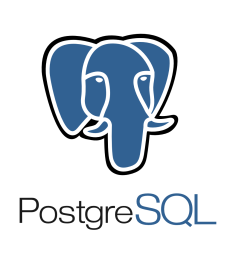

# PostgreSQL Tips & Tricks

[](http://forthebadge.com) [](http://forthebadge.com)  [](http://forthebadge.com)  [](http://forthebadge.com)

Quelques trucs et astuces sur PostgreSQL.

Ce projet propose un environnement de développement prêt à l'emploi avec :

- PostgreSQL 15
- pgAdmin 4 (interface web)
- Initialisation automatique de la base avec des fichiers `.sql` et `.csv`
- Compatible avec Visual Studio Code et Remote Containers

---



---

## 🚀 Prérequis

- [Docker Desktop](https://www.docker.com/products/docker-desktop/)
- [Visual Studio Code](https://code.visualstudio.com/)
- Extension **Remote - Containers** ou **Dev Containers**

## ⚙️ Démarrage rapide

1. **Ouvrir le dossier dans VS Code**
2. Cliquer sur `Reopen in Container` (via la palette de commande `Ctrl+Shift+P`)
3. Attends la création et le démarrage des containers

---

## 🌐 Accès pgAdmin

- URL : [http://localhost:5050](http://localhost:5050)
- Email : `admin@admin.com`
- Mot de passe : `admin`

💡 Une fois connecté, ajoute une connexion manuellement avec :

- Host : `postgres`
- Port : `5432`
- User : `dev`
- Password : `devpass`

---

## 🧩 Initialisation automatique

À la première exécution, PostgreSQL initialise :

- les **tables**
- les **données depuis les fichiers CSV**

via les scripts contenus dans le dossier `init/`.

Pour réinitialiser la base :

```bash
docker volume rm devcontainer_pgdata
```
---

## 📄 Fichiers importants

- init/init.sql : création des tables et chargement des CSV
- init/*.csv : données importées automatiquement
- .devcontainer/docker-compose.yml : configuration des services
- .devcontainer/devcontainer.json : config VS Code

---

## 🏗️ Structure du projet

```bash
.
├── .devcontainer/
│ ├── devcontainer.json
│ ├── docker-compose.yml
│ └── pgadmin_servers.json
├── init/
│ ├── init.sql
│ └── *.csv
├── scripts/
│ ├── audit/
│ │ └── *.sql
│ ├── performance-related-issues/
│ │ └── *.sql
│ ├── security/
│ │ └── *.sql
│ └── size-related-issues/
│   └── *.sql
└── README.md
```

### Scripts utiles

#### Audit

* [Obtient les statistiques de contenu d'une table](./scripts/audit/table-statistics.sql)
* [Vérifier le fillfactor pour chaque tables et index de la base de données](./scripts/audit/fill-factor-value.sql)
* [Trouver les index en doublon](./scripts/audit/duplicate-indexes.sql)
* [Trouver les index inutiles](./scripts/audit/useless-indexes.sql)
* [Obtenir la structure de la table](./scripts/audit/table-structure.sql)
* [Obtenir les statistiques d'utilisation](./scripts/audit/index-usage-statistics.sql)
* [Les tables sur lesquelles il manque un index](./scripts/audit/tables-need-indexing.sql)
* [Retourner les tables sur lesquelles il manque une clé primaire ou une clé unique](./scripts/audit/tables-without-pk-ui.sql)
* [Retourner les tables sur lesquelles il manque une clé primaire](./scripts/audit/tables-without-pk.sql)
* [Retourner les tables avec des champs de type Geometry non indexés](./scripts/audit/tables-without-indexes-on-geometry.sql)
* [Trouver les tables avec le plus de fragmentation](./scripts/audit/find_bloated_tables.sql)
* [Trouver les index manquants](./scripts/audit/missing-indexes.sql)
* [Rechercher une valeur dans les colonnes d'une table](./scripts/audit/search-in-every-field-in-a-table.sql)

#### Taille

* [Vérifier la taille de la base de données](./scripts/size-related-issues/db-size.sql)
* [Obtenir le nombre de bits gaspillés](./scripts/size-related-issues/wasted-bytes.sql)
* [Quelle table a le plus de dead tuples](./scripts/size-related-issues/dead-tuples.sql)
* [Quelle table ou index consomme le plus d'espace](./scripts/size-related-issues/most-space.sql)

#### Performance

* [Top 10 des requêtes les plus longues](./scripts/performance-related-issues/top-10-longest-queries.sql)
* [Obtenir les requêtes en cours d'exécution et les statuts de verrouillage](./scripts/performance-related-issues/running-queries.sql)
* [Tuer une requête](./scripts/performance-related-issues/kill.sql)

#### Securité

* [Retourne les autorisations par utilisateur](./scripts/security/user-grants.sql)

### Liens utiles

* [PostgreSQL SQL Tricks](https://postgres.cz/wiki/PostgreSQL_SQL_Tricks) - Tips & Tricks
* [PostgreSQL Index Maintenance](https://wiki.postgresql.org/wiki/Index_Maintenance) - Maintenance des index
* [Postgres Cheat Sheet](https://postgrescheatsheet.com/#/tables) - PGSQL cheat sheet
* [PGSQL commands & queries](https://dzone.com/articles/useful-postgresql-commandsqueries-part-1) - Commandes et requêtes utiles

## Réalisé avec

* [Git](https://git-scm.com)

## Contributions

Si vous souhaitez contribuer, lisez le fichier CONTRIBUTING.md pour savoir comment procéder.
